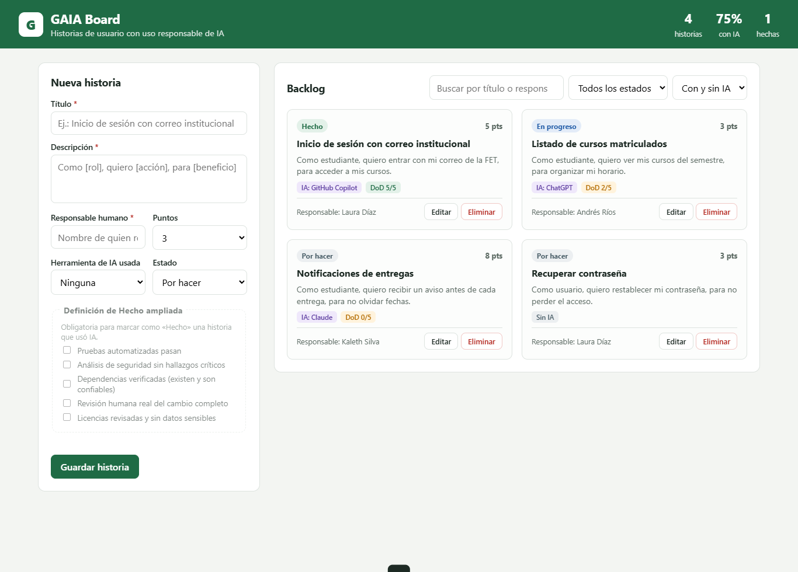
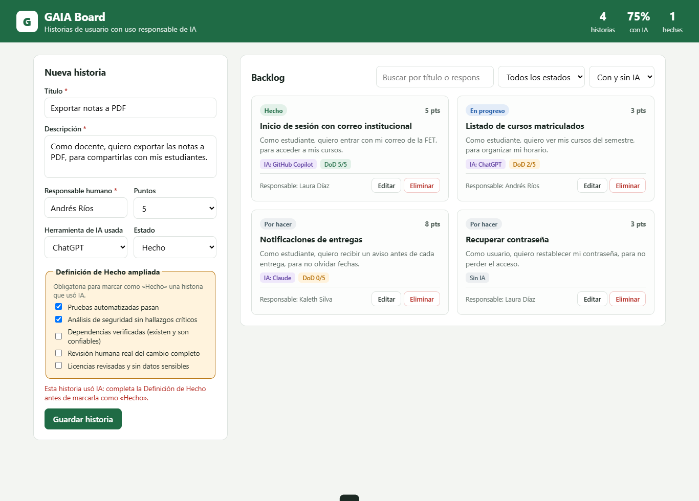
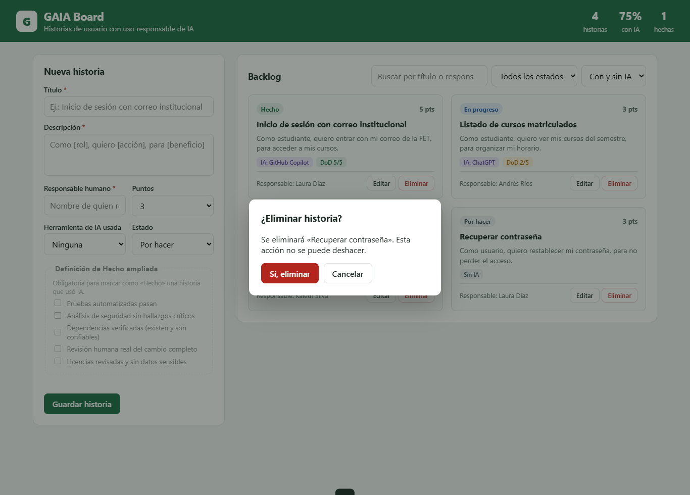
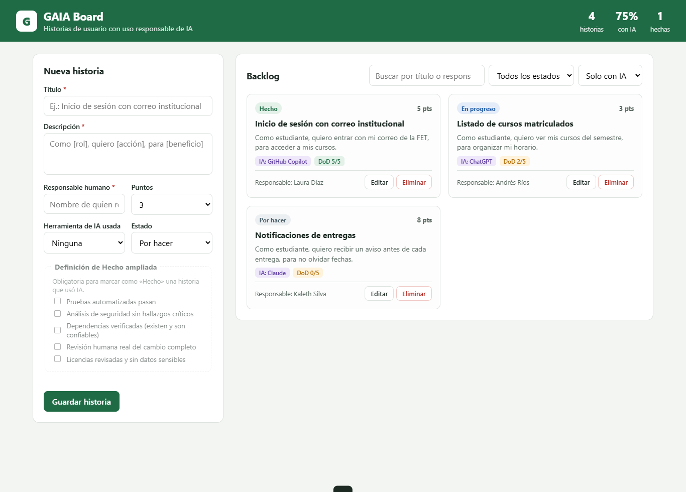

# GAIA Board

**Aplicación web CRUD de historias de usuario con uso responsable de IA**

Trabajo práctico del seminario *Gestión de Software Ágil asistido por Inteligencia Artificial*. Fundación Escuela Tecnológica de Neiva Jesús Oviedo Pérez (FET), Ingeniería de Software.

**Autor:** Kaleth David Silva

---

## Video explicativo

▶️ [Ver el video del desarrollo y la demo](ENLACE_DEL_VIDEO)

## Descripción

GAIA Board es un backlog sencillo para equipos Scrum. Permite **crear, ver, editar y eliminar historias de usuario**. Además, registra si en cada historia se usó una herramienta de IA (ChatGPT, Claude, Copilot, Cursor, etc.).

Su regla principal sale del artículo del seminario: **una historia que usó IA no puede marcarse como «Hecho» si no cumple la Definición de Hecho ampliada**. Esa definición tiene cinco puntos: pruebas, seguridad, dependencias verificadas, revisión humana y licencias. Además, cada historia debe tener un **responsable humano**, porque la IA ayuda pero no responde por el código.

| Operación | Dónde se ve en la app |
|---|---|
| **Create** | Formulario «Nueva historia» y botón *Guardar historia* |
| **Read** | Tarjetas del Backlog, buscador, filtros por estado y por uso de IA, métricas de la barra superior |
| **Update** | Botón *Editar*: carga la historia en el formulario y se guarda con *Guardar cambios* |
| **Delete** | Botón *Eliminar*, con una ventana de confirmación antes de borrar |

## Tecnologías utilizadas

- **HTML5**: estructura, formulario y `<dialog>` para la confirmación.
- **CSS3**: diseño responsive con Grid y Flexbox, en verde institucional.
- **JavaScript (ES6+) sin frameworks**: lógica del CRUD.
- **localStorage**: los datos se guardan en el navegador, sin servidor ni base de datos.

## Estructura del proyecto

```
gaia-board/
├── index.html        # Interfaz: formulario, listado y diálogo
├── css/
│   └── styles.css    # Estilos
├── js/
│   ├── storage.js    # Capa de datos: getAll, create, update, remove (localStorage)
│   └── app.js        # Lógica de interfaz: validación, render, filtros, eventos
└── capturas/         # Imágenes del README
```

## Cómo ejecutar el proyecto

**Opción 1, la más simple:**

1. Clona o descarga el repositorio:
   ```bash
   git clone https://github.com/KALETHDAVIDSILVASOTO21/gaia-board.git
   ```
2. Abre `index.html` con doble clic en cualquier navegador moderno (Chrome, Edge o Firefox).

**Opción 2, con servidor local** (por ejemplo, la extensión *Live Server* de VS Code):

1. Abre la carpeta en VS Code.
2. Haz clic derecho sobre `index.html` y elige **Open with Live Server**.

No necesita instalar dependencias. Para borrar todos los datos de prueba, abre las herramientas de desarrollador (F12), entra en **Application → Local Storage** y elimina la clave `gaia-board.stories`.

## Capturas de pantalla

**Listado del backlog (Read)**


**Regla de la Definición de Hecho: la app no deja marcar como «Hecho» una historia con IA si le faltan controles**


**Edición de una historia (Update)**


**Confirmación antes de eliminar (Delete)**


**Filtro de historias que usaron IA**


## Prompts utilizados

El desarrollo se guió con los siguientes prompts, en este orden. Después de cada respuesta revisé el código, lo ejecuté y lo ajusté.

### 1. Estructura inicial del CRUD
> Actúa como desarrollador web. Quiero crear una aplicación CRUD de historias de usuario para un equipo Scrum usando solo HTML, CSS y JavaScript puro, guardando los datos en localStorage. Cada historia debe tener: título, descripción, responsable, puntos (1, 2, 3, 5, 8, 13), estado (Por hacer, En progreso, Hecho) y la herramienta de IA usada (Ninguna, ChatGPT, Claude, GitHub Copilot, Cursor, Otra). Dame la estructura de archivos y el index.html con el formulario y la zona del listado.

**Qué pedí y para qué:** la base de la app. Definí los campos desde el principio para que la IA no inventara un modelo de datos diferente.

### 2. Capa de datos separada
> Crea un archivo storage.js que sea el único que toque localStorage, con las funciones getAll, create, update y remove. Cada historia debe tener un id único y la fecha de creación. Si los datos guardados están dañados, getAll debe devolver un arreglo vacío en vez de romper la app.

**Qué pedí y para qué:** separar los datos de la interfaz. Así, si después cambio localStorage por Firebase o una API, solo modifico un archivo.

### 3. Lógica del CRUD
> Ahora crea app.js: al enviar el formulario se crea la historia o, si estoy editando, se actualiza. Muestra las historias como tarjetas con botones Editar y Eliminar. Editar debe cargar los datos en el mismo formulario y cambiar el texto del botón a «Guardar cambios», con un botón para cancelar la edición.

**Qué pedí y para qué:** las cuatro operaciones del CRUD funcionando con un solo formulario para crear y editar.

### 4. Regla de negocio: Definición de Hecho ampliada
> Agrega al formulario una sección «Definición de Hecho ampliada» con 5 casillas: pruebas automatizadas, análisis de seguridad, dependencias verificadas, revisión humana real y licencias revisadas. Regla: si la historia usó una herramienta de IA y el estado es «Hecho», solo se puede guardar si las 5 casillas están marcadas; si no, muestra un mensaje de error debajo del formulario. Además, el responsable humano debe ser obligatorio.

**Qué pedí y para qué:** es la parte original del proyecto. Lleva a la práctica la propuesta del artículo del seminario: la IA se puede usar, pero con controles.

### 5. Seguridad en la interfaz
> Revisa el código: ¿hay riesgo de XSS al mostrar lo que escribe el usuario con innerHTML? Si lo hay, corrígelo con una función que escape los caracteres especiales.

**Qué pedí y para qué:** verificar que la IA no dejara una vulnerabilidad. Toda entrada del usuario pasa por `escapeHTML()` antes de mostrarse con `innerHTML`.

### 6. Confirmación de borrado
> Reemplaza el confirm() del navegador por una ventana de confirmación hecha con la etiqueta <dialog>, que muestre el título de la historia que se va a eliminar.

**Qué pedí y para qué:** evitar borrados accidentales con una confirmación más clara y acorde al diseño.

### 7. Búsqueda, filtros y métricas
> Agrega un buscador por título o responsable, un filtro por estado y otro por uso de IA (con IA o sin IA). En la barra superior muestra el total de historias, el porcentaje que usó IA y cuántas están hechas.

**Qué pedí y para qué:** completar la parte de *Read* y hacer visible cuánto se usa la IA en el equipo.

### 8. Diseño visual
> Dale estilo con CSS: barra superior verde (#1f6b45), formulario a la izquierda y tarjetas a la derecha con Grid, etiquetas de color por estado y por uso de IA, y que en celular todo quede en una sola columna. La sección de Definición de Hecho debe resaltarse en ámbar solo cuando se elige una herramienta de IA.

**Qué pedí y para qué:** una interfaz clara y responsive, con colores que indiquen el estado de un vistazo.

### 9. Refactorización
> Refactoriza app.js: usa delegación de eventos para los botones de las tarjetas en lugar de un listener por botón, separa la validación en su propia función y agrega comentarios breves en español que expliquen cada bloque (Create, Read, Update, Delete).

**Qué pedí y para qué:** dejar el código más limpio y fácil de explicar en el video.

### 10. Documentación
> Genera un README.md con: nombre del proyecto, descripción, tecnologías, estructura de carpetas, instrucciones para ejecutarlo, sección de capturas y lista de prompts usados.

**Qué pedí y para qué:** la documentación que pide la entrega. Después la revisé y la adapté.

## Verificación y uso responsable de la IA

- Probé manualmente las cuatro operaciones y la regla de la Definición de Hecho: una historia con IA y la DoD incompleta no se deja marcar como «Hecho».
- Revisé que el texto del usuario se escape antes de mostrarse (prevención de XSS).
- La app no usa librerías externas, así que no hay riesgo de dependencias inventadas por la IA.
- Ajusté nombres, textos, colores y reglas con mi propio criterio. El código final es mi responsabilidad y puedo explicar cada parte.

**Herramientas de IA usadas:** Claude (Anthropic), noviembre de 2026.
